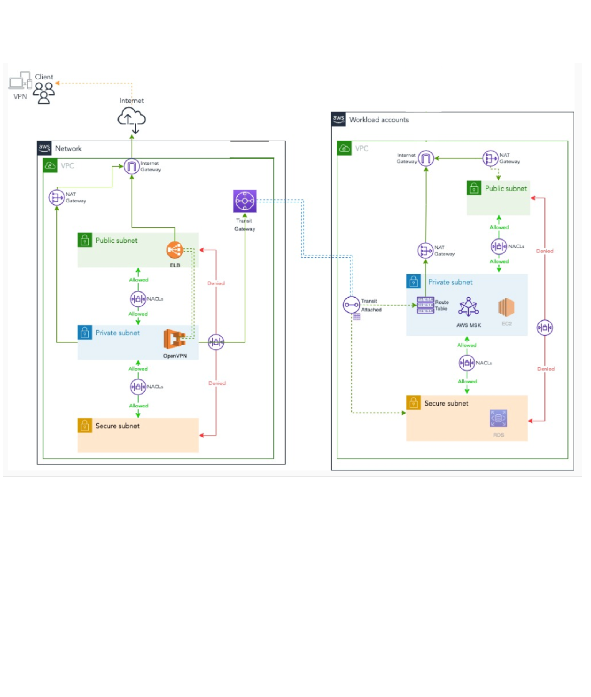

# Network
## Transit Gateway

The stack controlling the network resources is the **Network** stack.

Normally, the workload accounts (prod, nonprod, shared-services).

The Transit Gateway info per AWS accounts is below:

Accounts with 1 NAT Gateway cannot withstand an Availability Zone (AZ) failure. So it's recommended to have one NAT Gateway per AZ in production accounts.

In high-compliance environments, there might be no NAT Gateways as internet access is restricted to applications. In this case the use of a Proxy like Squid or Tinyproxy is recommended.
  - Transit gateway concepts

The following are the key concepts for transit gateways:

## Attachments — You can attach the following:

- One or more VPCs

- A Connect SD-WAN/third-party network appliance

- An AWS Direct Connect gateway

- A peering connection with another transit gateway

- A VPN connection to a transit gateway

##  Transit gateway Maximum Transmission Unit (MTU)
  The maximum transmission unit (MTU) of a network connection is the size, in bytes, of the largest permissible packet that can be passed over the connection. The larger the MTU of a connection, the more data that can be passed in a single packet. A transit gateway supports an MTU of 8500 bytes for traffic between VPCs, AWS Direct Connect, Transit Gateway Connect, and peering attachments. Traffic over VPN connections can have an MTU of 1500 bytes.

## Transit gateway route table
  - A transit gateway has a default route table and can optionally have additional route tables. A route table includes dynamic and static routes that decide the next hop based on the destination IP address of the packet. The target of these routes could be any transit gateway attachment. By default, transit gateway attachments are associated with the default transit gateway route table.

## Associations 
  - Each attachment is associated with exactly one route table. Each route table can be associated with zero to many attachments.

## Route propagation
  - A VPC, VPN connection, or Direct Connect gateway can dynamically propagate routes to a transit gateway route table. With a Connect attachment, the routes are propagated to a transit gateway route table by default. With a VPC, you must create static routes to send traffic to the transit gateway. With a VPN connection or a Direct Connect gateway, routes are propagated from the transit gateway to your on-premises router using Border Gateway Protocol (BGP). With a peering attachment, you must create a static route in the transit gateway route table to point to the peering attachment.

Transit Gateway is a Regional resource and can connect thousands of VPCs within the same AWS Region. You can create multiple Transit Gateway instances per Region, and you can connect to a maximum of three Transit Gateway instances over a single Direct Connect connection for hybrid connectivity. Typically, you can use just one Transit Gateway instance connecting all your VPC instances in a given Region, and use Transit Gateway routing tables to isolate them wherever needed. There is a valid case for creating multiple Transit Gateway instances to limit misconfiguration blast radius, segregate control plane operations and administrative ease-of-use.

With Transit Gateway peering, customers can peer their Transit Gateway instances within same or multiple Regions and route traffic between them. It uses the same underlying infrastructure as VPC peering, and is therefore encrypted. For more information, refer to Building a global network using AWS Transit Gateway Inter-Region peering and AWS Transit Gateway now supports Intra-Region Peering.

Place your organization’s Transit Gateway instance in its Network Services account. This enables centralized management by network engineers who manage the Network services account. Use AWS Resource Access Manager (RAM) to share a Transit Gateway instance for connecting VPCs across multiple accounts in your AWS Organization within the same Region. AWS RAM enables you to easily and securely share AWS resources with any AWS account, or within your AWS Organization. For more information, refer to the Automating AWS Transit Gateway attachments to a transit gateway in a central account blog post.

Transit Gateway also allows you to establish connectivity between SD-WAN infrastructure and AWS using Transit Gateway Connect. Use Transit GatewayConnect Border Gateway Protocol (BGP) for dynamic routing and Generic Routing Encapsulation (GRE) tunnel protocol for high performance, delivering up to 20 Gbps total bandwidth per Connect attachment (up to four Transit Gateway Connect peers per Connect attachment). By using Transit Gateway Connect, you can integrate both on-premises SD-WAN infrastructure or SD-WAN appliances running in the cloud through VPC attachment, or AWS Direct Connect attachment as the underlying transport layer. Refer to Simplify SD-WAN connectivity with AWS Transit Gateway Connect for reference architectures and detailed configuration.